# Project Context

> **Auto-generated by [code-mapper](https://github.com/your-org/code-mapper).**  
> Read this file instead of scanning source files — it captures the full structure at a fraction of the token cost.
> `CustomerSupport` · 71 files (python×71) · 172 classes · 167 functions · ~13,035 source lines

---
## File Structure

```
CustomerSupport/
├── api/
  └── __init__.py
  └── app.py
  └── deps.py
  └── routes.py
  └── security.py
└── app.py
├── background/
  └── __init__.py
  └── scheduler.py
└── bootstrap.py
├── faq_core/
  └── __init__.py
  └── cache.py
  └── confidence.py
  └── config.py
  └── errors.py
  ├── eval/
    └── __init__.py
    └── ragas_eval.py
  └── events.py
  └── gaps.py
  └── handoff.py
  └── intent_router.py
  ├── llm/
    └── __init__.py
    └── anthropic_gateway.py
    └── factory.py
    └── gateway.py
    └── openai_compatible_gateway.py
    └── presets.py
    └── prompts.py
    └── resilience.py
  └── metrics.py
  └── migrations.py
  └── models.py
  └── network_guard.py
  └── pii.py
  └── ports.py
  └── repository.py
  ├── retrieval/
    └── __init__.py
    └── benchmark.py
    └── chunk_store.py
    └── chunking.py
    └── embedders.py
    └── engine.py
    └── http_json.py
    └── indexer.py
    └── ingest.py
    └── ranking.py
    └── rerankers.py
    └── retriever.py
    └── vector_store.py
  ├── security/
    └── __init__.py
    └── errors.py
    └── jwks.py
    └── oauth.py
    └── origins.py
    └── policy.py
    └── ratelimit.py
    └── tokens.py
  └── service.py
  └── triage.py
├── formatters/
  └── __init__.py
  └── base.py
  └── markdown_formatter.py
  └── plain_formatter.py
  └── registry.py
├── observability/
  └── __init__.py
  └── alerting.py
  └── log.py
  └── tracing.py
└── remote_mcp.py
└── server.py
├── ui/
  └── __init__.py
  └── gradio_app.py
```

## Class Diagram

```mermaid
classDiagram
    class AnswerEngine["AnswerEngine"] {
        +generates_answers()
        +search()
        +retrieve()
        +generate()
        +verify()
        +add_document()
        +seed_from_entries()
        ...
    }
    class AnswerGenerationUnavailableError["AnswerGenerationUnavailableError"] {
        +__init__()
    }
    SupportError <|-- AnswerGenerationUnavailableError : extends
    class AnswerResponse["AnswerResponse"] {
        +query: str
        +answer: str
        +sources: list
        +confidence: float
    }
    _Model <|-- AnswerResponse : extends
    class AnswerSource["AnswerSource"] {
        +answer()
        +search_kb()
    }
    class AnthropicGateway["AnthropicGateway"] {
        +aclose()
        +__init__()
    }
    ChatCompletionGateway <|-- AnthropicGateway : extends
    class ApiKey["ApiKey"] {
        +name: str
        +digest: bytes
    }
    class AppConfig["AppConfig"] {
        +LLM_MODE: LLMMode
        +LLM_PROVIDER: str
        +LLM_MODEL: str
        +LLM_BASE_URL: str
        +secret_values()
    }
    class AsyncStampedeCache["AsyncStampedeCache"] {
        +make_key()
        +get_or_compute()
        +clear()
        +in_flight_keys()
        +__init__()
    }
    class AuthError["AuthError"] {
        +__init__()
    }
    class AuthMode["AuthMode"] {
        +uses_static_keys()
        +uses_oauth()
    }
    class AuthUnavailableError["AuthUnavailableError"] {
        +__init__()
    }
    AuthError <|-- AuthUnavailableError : extends
    class BGEReranker["BGEReranker"] {
        +name()
        +rerank()
        +__init__()
    }
    class BenchmarkCase["BenchmarkCase"] {
        +query: str
        +relevant: frozenset
    }
    class CacheBackend["CacheBackend"] {
        +get()
        +set()
        +clear()
    }
    class CategoryList["CategoryList"] {
        +kb_id: str
        +categories: list
    }
    _Model <|-- CategoryList : extends
    class ChainedVerifier["ChainedVerifier"] {
        +verify()
        +__init__()
    }
    class ChatCompletionGateway["«abstract» ChatCompletionGateway"] {
        +name()
        +can_generate()
        +model()
        +circuit_breaker()
        +generate_answer()
        +verify_answer()
        +classify_intent()
        ...
    }
    class Chunk["Chunk"] {
        +id: UUID
        +kb_id: NonEmptyStr
        +faq_id
        +document_id
        +source_type()
        +source_id()
    }
    _Model <|-- Chunk : extends
    class ChunkStore["ChunkStore"] {
        +source_hashes()
        +chunk_ids()
        +count()
        +list_chunks()
        +get_chunks()
        +fetch()
        +search_bm25()
        ...
    }
    class CircuitBreaker["CircuitBreaker"] {
        +state()
        +allow_request()
        +record_success()
        +record_failure()
        +__init__()
    }
    class CircuitState["CircuitState"] {
    }
    class Citation["Citation"] {
        +id: UUID
        +source_type: SourceType
        +source_id: UUID
        +title: str
    }
    _Model <|-- Citation : extends
    class CohereReranker["CohereReranker"] {
        +name()
        +rerank()
        +__init__()
    }
    class ConfidenceAssessment["ConfidenceAssessment"] {
        +score: float
        +level: ConfidenceLevel
        +components: dict
        +reasons: tuple
        +outcome()
    }
    class ConfidenceLevel["ConfidenceLevel"] {
    }
    class ConfidenceScorer["ConfidenceScorer"] {
        +thresholds()
        +assess()
        +__init__()
    }
    class ConfidenceSignal["ConfidenceSignal"] {
        +score: float
        +level: ConfidenceLevel
        +basis: Literal
        +calibrated: bool
    }
    _Model <|-- ConfidenceSignal : extends
    class ConfidenceThresholds["ConfidenceThresholds"] {
        +answer: float
        +caveat: float
        +similarity_floor: float
        +similarity_ceiling: float
    }
    class ConnectionRunner["ConnectionRunner"] {
        +run_in_connection()
    }
    class Document["Document"] {
        +id: UUID
        +kb_id: NonEmptyStr
        +title: NonEmptyStr
        +body: NonEmptyStr
    }
    _Model <|-- Document : extends
    class DocumentChange["DocumentChange"] {
    }
    class DocumentDraft["DocumentDraft"] {
        +title: NonEmptyStr
        +body: NonEmptyStr
        +format: DocumentFormat
        +source_uri: NonEmptyStr
    }
    _Model <|-- DocumentDraft : extends
    class DocumentFormat["DocumentFormat"] {
    }
    class Embedder["Embedder"] {
        +name()
        +dimension()
        +embed_documents()
        +embed_query()
    }
    class EmbeddingError["EmbeddingError"] {
    }
    RemoteServiceError <|-- EmbeddingError : extends
    class Endpoint["Endpoint"] {
        +setting: str
        +url: str
    }
    class Escalation["Escalation"] {
        +id: UUID
        +kb_id: NonEmptyStr
        +query_id
        +reason: NonEmptyStr
    }
    _Model <|-- Escalation : extends
    class EscalationActivity["EscalationActivity"] {
        +status: EscalationStatus
        +created_at: UtcTimestamp
    }
    _Model <|-- EscalationActivity : extends
    class EscalationDelivery["EscalationDelivery"] {
        +sink: str
        +delivered: bool
        +attempts: int
        +error: str
    }
    _Model <|-- EscalationDelivery : extends
    class EscalationNotFoundError["EscalationNotFoundError"] {
        +__init__()
    }
    NotFoundError <|-- EscalationNotFoundError : extends
    class EscalationRequest["EscalationRequest"] {
        +query_id
        +session_id
        +customer_goal: Annotated
        +reason: Annotated
    }
    _Model <|-- EscalationRequest : extends
    class EscalationResult["EscalationResult"] {
        +escalation_id: UUID
        +kb_id: str
        +status: EscalationStatus
        +query_id
    }
    _Model <|-- EscalationResult : extends
    class EscalationSink["EscalationSink"] {
        +name()
        +forwards()
        +deliver()
    }
    class EscalationStatus["EscalationStatus"] {
    }
    class EvalRecord["EvalRecord"] {
        +user_input: str
        +response: str
        +retrieved_contexts: tuple
        +reference: str
    }
    class EvalSample["EvalSample"] {
        +question: str
        +reference: str
    }
    class Event["Event"] {
        +kind: str
        +source: str
        +payload: Mapping
        +id: UUID
    }
    class EventBus["EventBus"] {
        +subscribe()
        +unsubscribe()
        +handlers_for()
        +emit()
        +publish()
        +drain()
        +__init__()
    }
    class FAQDraft["FAQDraft"] {
        +question: NonEmptyStr
        +answer: NonEmptyStr
        +category: NonEmptyStr
    }
    _Model <|-- FAQDraft : extends
    class FAQEntry["FAQEntry"] {
        +id: UUID
        +question: NonEmptyStr
        +answer: NonEmptyStr
        +category: NonEmptyStr
    }
    _Model <|-- FAQEntry : extends
    class FAQNotFoundError["FAQNotFoundError"] {
        +__init__()
    }
    NotFoundError <|-- FAQNotFoundError : extends
    class FAQRepository["FAQRepository"] {
        +vector_search_available()
        +run_in_connection()
        +schema_version()
        +close()
        +create()
        +create_many()
        +get()
        ...
    }
    class FAQStore["FAQStore"] {
        +create()
        +create_many()
        +get()
        +list_all()
        +list_categories()
        +count()
        +save_feedback()
        ...
    }
    MetricsStore <|-- FAQStore : extends
    class FeedbackActivity["FeedbackActivity"] {
        +rating: int
        +helpful: bool
        +created_at: UtcTimestamp
        +negative()
    }
    _Model <|-- FeedbackActivity : extends
    class FeedbackEntry["FeedbackEntry"] {
        +id: UUID
        +query_id: UUID
        +rating: int
        +comment: str
    }
    _Model <|-- FeedbackEntry : extends
    class FeedbackReceipt["FeedbackReceipt"] {
        +status: str
        +feedback_id: UUID
    }
    _Model <|-- FeedbackReceipt : extends
    class FeedbackRequest["FeedbackRequest"] {
        +query_id: UUID
        +rating: int
        +comment: str
        +helpful: bool
    }
    _Model <|-- FeedbackRequest : extends
    class FetchedResource["FetchedResource"] {
        +url: str
        +content_type: str
        +text: str
        +last_modified
    }
    class Formatter["Formatter"] {
        +name()
        +format()
    }
    class FormatterRegistry["FormatterRegistry"] {
        +register()
        +get()
        +names()
        +__init__()
    }
    class GapQuery["GapQuery"] {
        +limit: int
        +min_count: int
        +since
    }
    _Model <|-- GapQuery : extends
    class HashingEmbedder["HashingEmbedder"] {
        +name()
        +dimension()
        +embed_documents()
        +embed_query()
        +embed_sync()
        +__init__()
    }
    class HealthStatus["HealthStatus"] {
        +status: str
        +kb_id: str
        +llm_mode: LLMMode
        +answer_generation: bool
    }
    class HitEvidence["HitEvidence"] {
        +term_coverage: float
        +retrievers: int
        +bm25_rank
        +dense_rank
    }
    class HostOriginPolicy["HostOriginPolicy"] {
        +allowed_origins: frozenset
        +allowed_hosts
        +origin_allowed()
        +host_allowed()
    }
    class HttpxJWKSFetcher["HttpxJWKSFetcher"] {
        +fetch()
        +aclose()
        +__init__()
    }
    class HttpxUrlFetcher["HttpxUrlFetcher"] {
        +fetch()
        +__init__()
    }
    class HybridRetriever["HybridRetriever"] {
        +dense_enabled()
        +retrieve()
        +retrieve_with_evidence()
        +__init__()
    }
    class IndexSyncReport["IndexSyncReport"] {
        +kb_id: str
        +sources_indexed: int
        +sources_removed: int
        +fts_repaired: int
    }
    _Model <|-- IndexSyncReport : extends
    class IngestBatch["IngestBatch"] {
        +source: str
        +faqs: list
        +documents: list
        +skipped: list
    }
    _Model <|-- IngestBatch : extends
    class IngestError["IngestError"] {
    }
    SupportError <|-- IngestError : extends
    class IngestReport["IngestReport"] {
        +source: str
        +kb_id: str
        +faqs_added: int
        +faqs_duplicate: int
    }
    _Model <|-- IngestReport : extends
    class IntentRouter["IntentRouter"] {
        +route()
        +__init__()
    }
    class InvalidRequestError["InvalidRequestError"] {
    }
    SupportError <|-- InvalidRequestError : extends
    class JWKSCache["JWKSCache"] {
        +fetch_attempts_allowed()
        +signing_key()
        +aclose()
        +__init__()
    }
    class JWKSFetchError["JWKSFetchError"] {
    }
    class JWKSFetcher["JWKSFetcher"] {
        +fetch()
        +aclose()
    }
    class JWTVerifier["JWTVerifier"] {
        +verify()
        +__init__()
    }
    class JudgeSettings["JudgeSettings"] {
        +provider: str
        +protocol: WireProtocol
        +model: str
        +base_url: str
    }
    class JudgeUnavailableError["JudgeUnavailableError"] {
    }
    class KBSearchResult["KBSearchResult"] {
        +query_id: UUID
        +query: str
        +kb_id: str
        +llm_mode: LLMMode
    }
    _Model <|-- KBSearchResult : extends
    class KeyValueFormatter["KeyValueFormatter"] {
        +format()
        +__init__()
    }
    Formatter <|-- KeyValueFormatter : extends
    class KnowledgeGap["KnowledgeGap"] {
        +gap_id: str
        +representative_query: str
        +count: int
        +example_queries: list
    }
    _Model <|-- KnowledgeGap : extends
    class KnowledgeGapList["KnowledgeGapList"] {
        +kb_id: str
        +since: UtcTimestamp
        +scanned: int
        +gaps: list
    }
    _Model <|-- KnowledgeGapList : extends
    class KnowledgeIndexer["KnowledgeIndexer"] {
        +dense_enabled()
        +index_entries()
        +index_documents()
        +sync()
        +entry_source_hash()
        +document_source_hash()
        +chunk_entry()
        ...
    }
    class LLMGateway["LLMGateway"] {
        +name()
        +can_generate()
        +generate_answer()
        +classify_intent()
        +verify_answer()
        +aclose()
    }
    class LLMMode["LLMMode"] {
        +generates_answers()
    }
    class LLMUnavailableError["LLMUnavailableError"] {
    }
    SupportError <|-- LLMUnavailableError : extends
    class LogSink["LogSink"] {
        +name()
        +forwards()
        +deliver()
    }
    class MarkdownFormatter["MarkdownFormatter"] {
        +format()
    }
    class MemoryTTLCache["MemoryTTLCache"] {
        +get()
        +set()
        +clear()
        +__init__()
    }
    class MetricsQuery["MetricsQuery"] {
        +window_days: int
        +limit: int
    }
    _Model <|-- MetricsQuery : extends
    class MetricsStore["MetricsStore"] {
        +list_gap_queries()
        +list_query_activity()
        +list_escalation_activity()
        +list_feedback_activity()
    }
    class Migration["Migration"] {
        +version: int
        +name: str
        +sql: str
    }
    class MigrationError["MigrationError"] {
    }
    class ModeReport["ModeReport"] {
        +mode: str
        +cases: int
        +recall_at: dict
        +mrr: float
    }
    class NetworkPolicyError["NetworkPolicyError"] {
    }
    class NoOpReranker["NoOpReranker"] {
        +name()
        +rerank()
    }
    class NotFoundError["NotFoundError"] {
    }
    SupportError <|-- NotFoundError : extends
    class NullGateway["NullGateway"] {
        +name()
        +can_generate()
        +generate_answer()
        +classify_intent()
        +verify_answer()
        +aclose()
        +__init__()
    }
    class OAuthSettings["OAuthSettings"] {
        +issuer: str
        +resource: str
        +algorithms: frozenset
        +required_scopes: tuple
        +audiences()
    }
    class OpenAICompatibleEmbedder["OpenAICompatibleEmbedder"] {
        +name()
        +dimension()
        +embed_documents()
        +embed_query()
        +__init__()
    }
    class OpenAICompatibleGateway["OpenAICompatibleGateway"] {
        +base_url()
        +__init__()
    }
    ChatCompletionGateway <|-- OpenAICompatibleGateway : extends
    class Outcome["Outcome"] {
    }
    class OutcomeCounts["OutcomeCounts"] {
        +answer: int
        +answer_with_caveat: int
        +escalate: int
    }
    _Model <|-- OutcomeCounts : extends
    class PIIKind["PIIKind"] {
    }
    class PIIRedactor["PIIRedactor"] {
        +enabled()
        +redact()
        +__init__()
    }
    class Passage["Passage"] {
        +rank: int
        +citation_id: UUID
        +source_type: SourceType
        +source_id: UUID
    }
    _Model <|-- Passage : extends
    class PlainFormatter["PlainFormatter"] {
        +format()
    }
    class Principal["Principal"] {
        +key_id: str
        +method: AuthMethod
        +client_id: str
        +subject
    }
    class ProviderPreset["ProviderPreset"] {
        +name: str
        +protocol: WireProtocol
        +base_url: str
        +default_model: str
    }
    class QueryActivity["QueryActivity"] {
        +id: UUID
        +session_id
        +outcome: Outcome
        +confidence
    }
    _Model <|-- QueryActivity : extends
    class QueryLogRecord["QueryLogRecord"] {
        +id: UUID
        +kb_id: NonEmptyStr
        +query: NonEmptyStr
        +surface: NonEmptyStr
    }
    _Model <|-- QueryLogRecord : extends
    class QueryNotFoundError["QueryNotFoundError"] {
        +__init__()
    }
    NotFoundError <|-- QueryNotFoundError : extends
    class QueryRequest["QueryRequest"] {
        +query: NonEmptyStr
        +top_k: int
        +session_id
    }
    _Model <|-- QueryRequest : extends
    class RagasJudge["RagasJudge"] {
        +settings: JudgeSettings
        +llm: Any
        +embeddings: Any
    }
    class RateDecision["RateDecision"] {
        +allowed: bool
        +retry_after: int
    }
    class RecontactMetric["RecontactMetric"] {
        +horizon_hours: int
        +definition: str
        +sessions: int
        +eligible_sessions: int
    }
    _Model <|-- RecontactMetric : extends
    class RedactingFilter["RedactingFilter"] {
        +add_secrets()
        +redact()
        +filter()
        +__init__()
    }
    class RedactionResult["RedactionResult"] {
        +text: str
        +kinds: tuple
        +count: int
        +found()
    }
    class RemoteServiceError["RemoteServiceError"] {
    }
    class RerankResult["RerankResult"] {
        +index: int
        +score
    }
    class Reranker["Reranker"] {
        +name()
        +rerank()
    }
    class RerankerError["RerankerError"] {
    }
    RemoteServiceError <|-- RerankerError : extends
    class ResolutionMetrics["ResolutionMetrics"] {
        +kb_id: str
        +window_days: int
        +since: UtcTimestamp
        +until: UtcTimestamp
    }
    _Model <|-- ResolutionMetrics : extends
    class ResolvedLLM["ResolvedLLM"] {
        +provider: str
        +protocol: WireProtocol
        +base_url: str
        +model: str
    }
    class RetrievalAnswerEngine["RetrievalAnswerEngine"] {
        +retriever()
        +embedder()
        +generates_answers()
        +search()
        +generate()
        +verify()
        +retrieve()
        ...
    }
    class RetrievalResponse["RetrievalResponse"] {
        +query: str
        +passages: list
        +citations: list
        +sources: list
    }
    _Model <|-- RetrievalResponse : extends
    class RetrievalSettings["RetrievalSettings"] {
        +rrf_k: int
        +candidates: int
        +dedupe_threshold: float
    }
    class RetrievalStack["RetrievalStack"] {
        +retriever: HybridRetriever
        +indexer: KnowledgeIndexer
        +embedder: Embedder
        +vectors
    }
    class RetrievedChunk["RetrievedChunk"] {
        +chunk: Chunk
        +faq
        +fused_score: float
        +confidence: float
        +text()
        +context()
        +citation()
    }
    class Runtime["Runtime"] {
        +config: AppConfig
        +service: SupportService
        +engine: AnswerEngine
        +repo: FAQRepository
    }
    class SearchResult["SearchResult"] {
        +query_id: UUID
        +query: str
        +answer: str
        +confidence: float
    }
    _Model <|-- SearchResult : extends
    class SecurityConfigError["SecurityConfigError"] {
    }
    class SecurityMiddleware["SecurityMiddleware"] {
        +__init__()
    }
    class SecurityPolicy["SecurityPolicy"] {
        +mode: AuthMode
        +verifier
        +origins: HostOriginPolicy
        +key_limiter
        +requires_auth()
        +resource_metadata_url()
        +resource_metadata_paths()
        +protected_resource_metadata()
        +aclose()
    }
    class SentenceTransformerEmbedder["SentenceTransformerEmbedder"] {
        +name()
        +dimension()
        +embed_documents()
        +embed_query()
        +__init__()
    }
    class SkippedSource["SkippedSource"] {
        +source: str
        +reason: str
    }
    _Model <|-- SkippedSource : extends
    class SlidingWindowRateLimiter["SlidingWindowRateLimiter"] {
        +check()
        +__init__()
    }
    class SourceLoader["SourceLoader"] {
        +load()
        +__init__()
    }
    class SourceRef["SourceRef"] {
        +citation_id: UUID
        +source_type: SourceType
        +source_id: UUID
        +title: str
    }
    _Model <|-- SourceRef : extends
    class SourceType["SourceType"] {
    }
    class SqliteVecStore["SqliteVecStore"] {
        +name()
        +prepare()
        +upsert()
        +delete()
        +ids()
        +search()
        +__init__()
    }
    class StaticTokenVerifier["StaticTokenVerifier"] {
        +matches()
        +verify()
        +__init__()
    }
    class StoredChunk["StoredChunk"] {
        +chunk: Chunk
        +faq
    }
    class SuggestedTopic["SuggestedTopic"] {
        +gap_id: str
        +topic: str
        +queries: int
        +action: TopicAction
    }
    _Model <|-- SuggestedTopic : extends
    class SupportError["SupportError"] {
        +code: ClassVar
        +status_code: ClassVar
        +to_dict()
        +__init__()
    }
    class SupportMCPServer["SupportMCPServer"] {
        +llm_mode: LLMMode
        +call_tool()
    }
    class SupportPolicy["SupportPolicy"] {
        +thresholds: ConfidenceThresholds
        +triage: TriagePolicy
        +self_check: bool
        +gap_cluster_threshold: float
        +from_config()
    }
    class SupportService["SupportService"] {
        +kb_id()
        +llm_mode()
        +generates_answers()
        +search()
        +answer()
        +search_kb()
        +create_escalation()
        ...
    }
    class TextChunk["TextChunk"] {
        +heading: str
        +content: str
    }
    class TokenVerifier["TokenVerifier"] {
        +verify()
    }
    class TranscriptTurn["TranscriptTurn"] {
        +role: Literal
        +text: Annotated
    }
    _Model <|-- TranscriptTurn : extends
    class TriageDecision["TriageDecision"] {
        +outcome: Outcome
        +reasons: tuple
        +caveat: str
        +escalate()
    }
    class TriagePolicy["TriagePolicy"] {
        +enabled: frozenset
        +frustration_terms: tuple
        +legal_terms: tuple
        +medical_terms: tuple
        +text_triggers()
        +is_repeated_rephrase()
        +similarity()
    }
    class UnknownFormatterError["UnknownFormatterError"] {
    }
    class UrlFetcher["UrlFetcher"] {
        +fetch()
    }
    class VectorStore["VectorStore"] {
        +name()
        +upsert()
        +delete()
        +ids()
        +search()
    }
    class WebhookSink["WebhookSink"] {
        +name()
        +forwards()
        +deliver()
        +__init__()
    }
    class WeeklyGapReport["WeeklyGapReport"] {
        +kb_id: str
        +generated_at: UtcTimestamp
        +window_days: int
        +since: UtcTimestamp
    }
    _Model <|-- WeeklyGapReport : extends
    class WireProtocol["WireProtocol"] {
    }
    class _Cluster["_Cluster"] {
        +representative: str
        +vector: list
        +key: str
        +records: list
    }
    class _Computed["_Computed"] {
        +retrieval: RetrievalResponse
        +assessment: ConfidenceAssessment
        +answer: str
        +generated: bool
    }
    class _KeyLock["_KeyLock"] {
        +lock: Lock
        +users: int
    }
    class _Kind["_Kind"] {
    }
    class _MarkdownExtractor["_MarkdownExtractor"] {
        +handle_starttag()
        +handle_endtag()
        +handle_data()
        +__init__()
    }
    class _Model["_Model"] {
    }
    class _Outcome["_Outcome"] {
        +query_id: UUID
        +prepared: _Prepared
        +computed: _Computed
        +decision: TriageDecision
        +confidence()
    }
    class _Prepared["_Prepared"] {
        +request: QueryRequest
        +redacted: str
        +pii_kinds: tuple
        +triggers: tuple
        +retrieval_query()
    }
    class _RawScores["_RawScores"] {
        +bm25_rank: dict
        +dense_rank: dict
        +bm25: dict
        +dense: dict
    }
    class _Section["_Section"] {
        +heading: str
        +lines: list
    }
    class _SharedService["_SharedService"] {
        +lifespan()
        +__init__()
    }
```

## Module Dependencies

```mermaid
graph TD
    __init__ --> base
    __init__ --> markdown_formatter
    __init__ --> plain_formatter
    __init__ --> registry
    alerting --> log
    alerting --> resilience
    anthropic_gateway --> errors
    anthropic_gateway --> gateway
    app --> errors
    app --> routes
    app --> security
    benchmark --> config
    benchmark --> engine
    benchmark --> models
    benchmark --> repository
    bootstrap --> config
    bootstrap --> events
    bootstrap --> handoff
    bootstrap --> ingest
    bootstrap --> log
    bootstrap --> models
    bootstrap --> network_guard
    bootstrap --> pii
    bootstrap --> repository
    bootstrap --> scheduler
    bootstrap --> service
    bootstrap --> tracing
    chunk_store --> models
    chunk_store --> ranking
    chunk_store --> repository
    confidence --> ranking
    config --> models
    deps --> service
    embedders --> http_json
    embedders --> log
    embedders --> ranking
    engine --> chunk_store
    engine --> embedders
    engine --> indexer
    engine --> log
    engine --> models
    engine --> rerankers
    engine --> retriever
    engine --> tracing
    engine --> vector_store
    events --> log
    events --> models
    factory --> alerting
    factory --> presets
    factory --> resilience
    gaps --> models
    gaps --> ranking
    gateway --> errors
    gateway --> models
    gateway --> prompts
    gateway --> tracing
    gradio_app --> errors
    handoff --> http_json
    handoff --> log
    handoff --> models
    indexer --> chunking
    indexer --> log
    indexer --> models
    indexer --> ranking
    indexer --> retriever
    ingest --> chunking
    ingest --> errors
    ingest --> log
    ingest --> models
    intent_router --> log
    intent_router --> tracing
    jwks --> errors
    jwks --> log
    jwks --> network_guard
    log --> pii
    markdown_formatter --> models
    metrics --> confidence
    metrics --> events
    metrics --> gaps
    metrics --> models
    metrics --> tracing
    models --> confidence
    network_guard --> errors
    network_guard --> models
    network_guard --> origins
    oauth --> errors
    oauth --> tokens
    openai_compatible_gateway --> errors
    openai_compatible_gateway --> gateway
    openai_compatible_gateway --> http_json
    origins --> errors
    plain_formatter --> models
    policy --> errors
    policy --> jwks
    policy --> log
    policy --> network_guard
    policy --> oauth
    policy --> origins
    policy --> ratelimit
    policy --> tokens
    ragas_eval --> embedders
    ragas_eval --> presets
    registry --> markdown_formatter
    registry --> plain_formatter
    remote_mcp --> models
    remote_mcp --> security
    remote_mcp --> server
    repository --> confidence
    repository --> log
    repository --> migrations
    repository --> models
    rerankers --> http_json
    rerankers --> log
    retriever --> confidence
    retriever --> log
    retriever --> models
    retriever --> ranking
    retriever --> rerankers
    retriever --> tracing
    routes --> deps
    routes --> errors
    routes --> models
    routes --> service
    scheduler --> events
    scheduler --> log
    security --> errors
    security --> log
    security --> policy
    security --> tokens
    server --> bootstrap
    server --> config
    server --> errors
    server --> models
    server --> service
    service --> cache
    service --> confidence
    service --> embedders
    service --> errors
    service --> events
    service --> gaps
    service --> handoff
    service --> log
    service --> metrics
    service --> models
    service --> pii
    service --> ranking
    service --> triage
    tokens --> errors
    tracing --> log
    triage --> confidence
    triage --> embedders
    triage --> ranking
    vector_store --> log
```



## Symbol Index


**`api/app.py`** `python`
> FastAPI application factory with a plain, self-owned lifespan.
- `def create_app(service_lifespan: ServiceLifespan) → FastAPI`  — Build the REST/WS app; *service_lifespan* provides the service per run.

**`api/deps.py`** `python`
> Typed FastAPI dependency aliases.
- `def get_service(request: Request) → SupportService`  — Return the service the application lifespan placed on ``app.state``.

**`api/routes.py`** `python`
> REST + WebSocket routes — thin adapters over :class:`SupportService`.
- `class HealthStatus(BaseModel)`
- `async def health(service: ServiceDep) → HealthStatus`
- `async def search(request: QueryRequest, service: ServiceDep) → SearchResult`
- `async def search_kb(request: QueryRequest, service: ServiceDep) → KBSearchResult`
- `async def answer(request: QueryRequest, service: ServiceDep) → SearchResult`
- `async def get_faq(faq_id: str, service: ServiceDep) → FAQEntry`
- `async def add_faq(draft: FAQDraft, service: ServiceDep) → FAQEntry`
- `async def list_categories(service: ServiceDep) → CategoryList`
- `async def submit_feedback(feedback: FeedbackRequest, service: ServiceDep) → FeedbackReceipt`
- `async def create_escalation(request: EscalationRequest, service: ServiceDep) → EscalationResult`
- `async def get_escalation(escalation_id: str, service: ServiceDep) → EscalationResult`
- `async def list_knowledge_gaps(service: ServiceDep, limit: int, min_count: int, since) → KnowledgeGapList`
- `async def resolution_metrics(service: ServiceDep, window_days: int) → ResolutionMetrics`
- `async def weekly_gap_report(service: ServiceDep, window_days: int, limit: int) → WeeklyGapReport`
- `async def ws_chat(websocket: WebSocket) → None`

**`api/security.py`** `python`
> ASGI security middleware shared by the REST/WebSocket app and the MCP HTTP app.
- `class SecurityMiddleware`  — Enforces a :class:`~faq_core.security.policy.SecurityPolicy` on an ASGI app.
- `def www_authenticate(policy: SecurityPolicy, err: AuthError) → str`  — The RFC 6750 / RFC 9728 challenge for *err* (fixed strings only, no token).
- `def protected_resource_metadata_routes(policy: SecurityPolicy) → list`  — RFC 9728 metadata routes (path-inserted and root); empty without OAuth.

**`app.py`** `python`
> CLI entry point — ``python app.py --mode mcp|api|ui|ingest|report``.
- `def run_mcp() → None`  — Serve the MCP tools over stdio (services start in the server lifespan).
- `def run_mcp_http(host: str, port: int) → None`  — Serve the MCP tools over authenticated Streamable HTTP at ``/mcp``.
- `def run_api(host: str, port: int) → None`  — Serve the FastAPI REST + WebSocket app (services start in the app lifespan).
- `def run_ui() → None`  — Serve the Gradio dev UI (search only, so no background scheduler).
- `def run_ingest(sources: Sequence) → int`  — Ingest *sources*; print one JSON report per source; return the exit code.
- `def run_report(window_days: int, limit: int, output) → int`  — Print (or write to *output*) the Markdown gap report; return the exit code.
- `def preflight(bind_host) → int`  — Refuse to start when ``LLM_MODE=offline`` meets a non-local endpoint.
- `def serve_http(mode: str, host: str, port: int) → int`  — Run an HTTP surface; return 2 (JSON error on stderr) on unsafe security settings
- `def main() → None`

**`background/scheduler.py`** `python`
> Background re-indexing: ``faq.added`` → APScheduler job → answer engine.
- `async def reindex_faq(faq_id: str) → None`  — Background job: fetch the FAQ entry by id and index it in the answer engine.
- `def create_scheduler(config: AppConfig, engine: AnswerEngine, repo: FAQStore, events: EventBus) → AsyncScheduler`  — Create the scheduler and subscribe it to ``faq.added`` on *events*.

**`bootstrap.py`** `python`
> Composition root: builds the runtime once and drives its lifecycle.
- `class Runtime`  — Every long-lived object of one running process.
- `def assemble_runtime(config: AppConfig, engine: AnswerEngine, repo: FAQRepository) → Runtime`  — Wire the service, event bus, re-index scheduler and ingest loader.
- `def build_runtime(config: AppConfig) → Runtime`  — Build the production runtime (blocking: may load models, migrates the DB).
- `def build_security(config: AppConfig) → SecurityPolicy`  — Build the security policy of an HTTP surface bound to *bind_host*.
- `def load_seed_drafts(path: Path) → list`  — Read seed FAQ entries from a JSON list of ``{question, answer, category}``.
- `async def prepare_knowledge_base(runtime: Runtime) → None`  — Seed an empty knowledge base from *seed_path*, then sync the retrieval index.
- `async def serve(runtime: Runtime) → AsyncIterator`  — Run *runtime*: prepare the knowledge base, run the scheduler; close LLM + DB on 
- `async def production_service() → AsyncIterator`  — :data:`~faq_core.service.ServiceLifespan` for real deployments.
- `async def ingest_sources(runtime: Runtime, sources: Sequence) → list`  — Load, store and index each of *sources* into *runtime*'s knowledge base.
- `async def run_ingest(sources: Sequence) → list`  — Production entry point for ``python app.py --mode ingest``.
- `async def report_gaps(runtime: Runtime, window_days: int, limit: int) → WeeklyGapReport`  — Build the weekly knowledge-gap report from *runtime*'s database, then close it.
- `async def run_report(window_days: int, limit: int) → WeeklyGapReport`  — Production entry point for ``python app.py --mode report``.

**`faq_core/cache.py`** `python`
> In-process TTL cache with async, per-key stampede protection.
- `class CacheBackend(Protocol)`  — Structural shape of a synchronous key/value store with per-entry TTL.
  methods: `get`, `set`, `clear`
- `class MemoryTTLCache`  — Bounded in-memory TTL cache with least-recently-used eviction.
  methods: `get`, `set`, `clear`
- `class AsyncStampedeCache`  — Serialise async cache misses per key over a :class:`CacheBackend`.
  methods: `make_key`, `get_or_compute`, `clear`, `in_flight_keys`
- `class _KeyLock`

**`faq_core/confidence.py`** `python`
> Answer confidence from retrieval evidence (plan §4, Phase 4).
- `class ConfidenceLevel(StrEnum)`
- `class Outcome(StrEnum)`  — What the caller should do with a result (stable values).
- `class HitEvidence`  — Raw retrieval evidence for the top passage of one query.
- `class ConfidenceThresholds`  — Score cut-offs and the similarity scale (``CONFIDENCE_*`` settings).
- `class ConfidenceAssessment`  — Score (0..1), level, the components used and why it is not high.
  methods: `outcome`
- `class ConfidenceScorer`  — Turns :class:`HitEvidence` into a :class:`ConfidenceAssessment`.
  methods: `thresholds`, `assess`
- `def content_terms(text: str) → set`  — Stemmed content words of *text* (stopwords and 1-letter tokens dropped).
- `def term_coverage(query: str, passage: str) → float`  — Share of *query*'s content terms that occur in *passage* (0.0 when it has none).

**`faq_core/config.py`** `python`
> Application configuration — the only place ``.env`` is read.
- `class AppConfig(BaseSettings)`
  methods: `secret_values`
- `def get_config() → AppConfig`  — Singleton accessor — reads .env exactly once.

**`faq_core/errors.py`** `python`
> Domain exceptions raised by :class:`faq_core.service.SupportService`.
- `class SupportError(Exception)`  — Base class for all expected (non-bug) failures of the support core.
  methods: `to_dict`
- `class NotFoundError(SupportError)`  — A requested resource does not exist.
- `class FAQNotFoundError(NotFoundError)`  — No FAQ entry exists for the requested id.
- `class QueryNotFoundError(NotFoundError)`  — No logged query exists for the requested ``query_id``.
- `class EscalationNotFoundError(NotFoundError)`  — No escalation exists for the requested id.
- `class InvalidRequestError(SupportError)`  — Caller-supplied input failed a business-rule check.
- `class IngestError(SupportError)`  — An ingest source could not be read, fetched or parsed.
- `class AnswerGenerationUnavailableError(SupportError)`  — This server does not generate answers in its ``LLM_MODE`` (``client``).
- `class LLMUnavailableError(SupportError)`  — The configured LLM provider failed, refused, or its circuit breaker is open.

**`faq_core/eval/ragas_eval.py`** `python`
> RAGAS evaluation of generated answers: faithfulness, answer relevancy, context precision.
- `class JudgeUnavailableError(RuntimeError)`  — The configuration cannot drive a RAGAS judge (the message says why; never a secr
- `class EvalSample`  — One curated question with its reference (ground-truth) answer.
- `class EvalRecord`  — What the service produced for one :class:`EvalSample`, in ragas field names.
- `class JudgeSettings`  — The effective judge LLM endpoint (no secrets).
- `class RagasJudge`  — A ragas judge LLM (``InstructorBaseRagasLLM``) and embeddings (``BaseRagasEmbedd
- `class AnswerSource(Protocol)`  — The two :class:`~faq_core.service.SupportService` calls the evaluation needs.
  methods: `answer`, `search_kb`
- `async def collect_records(service: AnswerSource, samples: Sequence) → list`  — Answer every sample through *service* and pair it with its retrieved passages.
- `def resolve_judge_settings(config: AppConfig) → JudgeSettings`  — Derive the judge LLM from the project's ``LLM_*`` settings.
- `def require_semantic_embedder(embedder: Embedder) → None`  — Refuse the hashing embedder: answer relevancy compares meanings, not tokens.
- `def build_judge(config: AppConfig, embedder: Embedder) → RagasJudge`  — Build the ragas judge LLM and embeddings from *config* and the index *embedder*.
- `def disable_ragas_telemetry() → None`  — Turn off ragas' default usage analytics (an outbound call to the vendor).
- `async def score_records(records: Sequence, judge: RagasJudge) → dict`  — Score *records* with the three collections metrics; return each metric's mean.
- `def metric_value(result: object) → float`  — ``MetricResult.value`` as a float; missing, non-numeric or NaN values become 0.0
- `def threshold_failures(scores: Mapping, thresholds: Mapping) → list`  — Describe every metric below its threshold (a missing score fails); empty = pass.
- `def langfuse_scores(scores: Mapping) → dict`  — Prefix metric names for :func:`observability.tracing.push_evaluation_scores`.

**`faq_core/events.py`** `python`
> Tiny typed in-process event bus.
- `class Event`  — An immutable domain event.
- `class EventBus`  — Async publish/subscribe bus scoped to one process (one per runtime).
  methods: `subscribe`, `unsubscribe`, `handlers_for`, `emit`, `publish`, `drain`
- `def build_faq_added_event(faq_id: str, category: str, kb_id: str) → Event`
- `def build_faq_indexed_event(faq_id: str, kb_id: str) → Event`  — The background job finished indexing an added entry (answer cache is stale).
- `def build_query_answered_event(query_id: str, query: str, answer: str) → Event`  — *query* and *answer* must already be PII-redacted.
- `def build_query_escalated_event(query_id: str, reasons: str) → Event`  — A query's outcome was ``escalate`` (*reasons*: comma-joined codes).
- `def build_gap_logged_event(query_id: str, query: str, outcome: str, kb_id: str) → Event`  — A query entered the knowledge-gap log (*query* is redacted).
- `def build_escalation_created_event(escalation_id: str, reasons: str) → Event`
- `def build_feedback_received_event(feedback_id: str, query_id: str, rating: int) → Event`
- `def build_metrics_reported_event(kb_id: str, window_days: int) → Event`  — Resolution metrics were computed (aggregates only — no query text).

**`faq_core/gaps.py`** `python`
> Knowledge-gap clustering: turn the gap log into a ranked content backlog.
- `class _Cluster`
- `async def cluster_gaps(records: Sequence, embedder: Embedder) → list`  — Cluster gap-log *records* (any order) into ranked :class:`KnowledgeGap` items.

**`faq_core/handoff.py`** `python`
> Escalation hand-off: the context packet and pluggable delivery sinks.
- `class EscalationSink(Protocol)`  — Delivers a stored escalation to whoever handles hand-offs.
  methods: `name`, `forwards`, `deliver`
- `class LogSink`  — Logs that an escalation exists (no packet text); the DB row is the hand-off.
  methods: `name`, `forwards`, `deliver`
- `class WebhookSink`  — Signed JSON ``POST`` of the packet (see module docstring).
  methods: `name`, `forwards`, `deliver`
- `def sign_payload(secret: bytes, timestamp: str, body: bytes) → str`  — ``sha256=<hex>`` HMAC of ``"{timestamp}.{body}"`` — what receivers recompute.
- `def verify_signature(secret: bytes, timestamp: str, body: bytes, signature: str) → bool`  — Constant-time check of a received :data:`SIGNATURE_HEADER` value.
- `def create_escalation_sink(config: AppConfig) → EscalationSink`  — Build the sink selected by ``ESCALATION_SINK`` (``log`` | ``webhook``).
- `def build_packet() → dict`  — The hand-off packet (schema :data:`PACKET_SCHEMA`); every text is already redact

**`faq_core/intent_router.py`** `python`
> LLM-based intent routing for free-form (non-MCP) input.
- `class IntentRouter`  — Classify a query into an action name via the LLM.
  methods: `route`

**`faq_core/llm/anthropic_gateway.py`** `python`
> Gateway adapter for the Anthropic Messages API, through the official ``anthropic`` SDK.
- `class AnthropicGateway(ChatCompletionGateway)`  — :class:`~faq_core.llm.gateway.LLMGateway` over the Anthropic Messages API.
  methods: `aclose`

**`faq_core/llm/factory.py`** `python`
> Builds the :class:`~faq_core.llm.gateway.LLMGateway` for the configured mode.
- `def create_llm_gateway(config: AppConfig) → LLMGateway`  — Return the gateway for ``LLM_MODE`` / ``LLM_PROVIDER``.

**`faq_core/llm/gateway.py`** `python`
> ``LLMGateway`` — the one interface the core uses to reach a language model.
- `class LLMGateway(Protocol)`  — What the answer engine and intent router need from a language model.
  methods: `name`, `can_generate`, `generate_answer`, `classify_intent`, `verify_answer`, `aclose`
- `«abstract» class ChatCompletionGateway(ABC)`  — Shared behaviour of the provider adapters (see module docstring).
  methods: `name`, `can_generate`, `model`, `circuit_breaker`, `generate_answer`, `verify_answer`, `classify_intent`, `aclose`
- `class NullGateway`  — ``LLM_MODE=client``: there is no LLM on this server.
  methods: `name`, `can_generate`, `generate_answer`, `classify_intent`, `verify_answer`, `aclose`
- `def build_rag_prompt(query: str, context_docs: Sequence) → str`  — The user turn for answer generation: numbered passages, then the question.
- `def build_self_check_prompt(query: str, context_docs: Sequence, answer: str) → str`  — The user turn for the self-check: passages, question, then the draft answer.
- `def parse_self_check(text: str)`  — ``True`` for SUPPORTED, ``False`` for UNSUPPORTED, ``None`` when unparseable.

**`faq_core/llm/openai_compatible_gateway.py`** `python`
> Gateway adapter for OpenAI-compatible ``POST {base_url}/chat/completions`` APIs.
- `class OpenAICompatibleGateway(ChatCompletionGateway)`  — :class:`~faq_core.llm.gateway.LLMGateway` over ``/chat/completions``.
  methods: `base_url`

**`faq_core/llm/presets.py`** `python`
> LLM provider presets selected by ``LLM_PROVIDER``.
- `class WireProtocol(StrEnum)`  — The HTTP API a provider speaks — decides which gateway adapter is built.
- `class ProviderPreset`  — Defaults for one ``LLM_PROVIDER`` value.
- `class ResolvedLLM`  — The effective LLM settings after applying overrides. Holds no secrets.
- `def get_preset(provider: str) → ProviderPreset`  — Return the preset for an ``LLM_PROVIDER`` value (case-insensitive, aliases ok).
- `def resolve_llm_settings(config: AppConfig) → ResolvedLLM`  — Apply ``LLM_BASE_URL`` / ``LLM_MODEL`` / ``LLM_MAX_TOKENS`` over the preset.
- `def api_key_for(config: AppConfig, resolved: ResolvedLLM) → SecretStr`  — The key setting a provider uses: ``ANTHROPIC_API_KEY`` or ``LLM_API_KEY``.

**`faq_core/llm/resilience.py`** `python`
> A small circuit breaker for LLM provider calls.
- `class CircuitState(StrEnum)`
- `class CircuitBreaker`  — Consecutive-failure circuit breaker.
  methods: `state`, `allow_request`, `record_success`, `record_failure`

**`faq_core/metrics.py`** `python`
> Resolution metrics and the weekly knowledge-gap report (plan §4, Phase 6).
- `def window_bounds(window_days: int, until: datetime) → tuple`  — Return ``(since, until)`` for a window of *window_days* ending at *until*.
- `def safe_rate(numerator: int, denominator: int)`  — ``numerator / denominator`` rounded to 4 decimals, ``None`` when nothing to divi
- `def count_outcomes(queries: Iterable) → OutcomeCounts`
- `def recontact_proxy(queries: Sequence) → RecontactMetric`  — Compute the 48h re-contact proxy (see the module docstring).
- `def compute_resolution_metrics() → ResolutionMetrics`  — Combine the window's activity into :class:`ResolutionMetrics`.
- `def metric_scores(metrics: ResolutionMetrics) → dict`  — Numeric metrics under stable names, for the trace layer (``None`` = not measurab
- `def is_policy_only(gap: KnowledgeGap) → bool`  — ``True`` when every query in *gap* was escalated for policy reasons only.
- `def suggest_topics(gaps: Sequence) → tuple`  — Turn ranked *gaps* into content suggestions; return them and the policy-only cou
- `def build_weekly_gap_report(metrics: ResolutionMetrics, gaps: Sequence) → WeeklyGapReport`  — Assemble the structured report and its Markdown rendering.
- `def md_text(text: str, max_chars: int) → str`  — Make stored (redacted) customer text safe inside one Markdown line.
- `def render_weekly_gap_report(metrics: ResolutionMetrics, gaps: Sequence, topics: Sequence) → str`  — Render the weekly knowledge-gap report as Markdown (customer text escaped).
- `async def collect_resolution_metrics(store: MetricsStore, embedder: Embedder) → tuple`  — Read the window's activity from *store* and compute the metrics.
- `def publish_metrics(metrics: ResolutionMetrics, events: EventBus) → None`  — Push *metrics* to the trace layer (no-op without Langfuse) and emit ``metrics.re

**`faq_core/migrations.py`** `python`
> Versioned SQL migrations for the SQLite support database.
- `class Migration`
- `class MigrationError(RuntimeError)`  — A migration failed; the database was rolled back to its previous version.
- `def current_version(conn: Connection) → int`  — Return the highest applied migration version (0 for an unmanaged database).
- `def apply_migrations(conn: Connection, migrations: tuple) → list`  — Apply every pending migration in order and return the versions applied.

**`faq_core/models.py`** `python`
> Pydantic v2 domain models shared by every surface.
- `class LLMMode(StrEnum)`  — Who writes the reply (``LLM_MODE``; plan §2).
  methods: `generates_answers`
- `class _Model(BaseModel)`
- `class FAQDraft(_Model)`  — Input for creating an FAQ entry (no server-assigned fields).
- `class FAQEntry(_Model)`  — A stored FAQ entry. Also the ``add_faq_entry``/``get_faq_entry`` tool result.
- `class QueryRequest(_Model)`  — Input for a knowledge-base search.
- `class SourceType(StrEnum)`  — What a retrieved passage was cut from.
- `class Citation(_Model)`  — One retrieved passage backing an answer (an item of ``citations[]``).
- `class AnswerResponse(_Model)`  — Raw output of the answer engine for one query.
- `class SearchResult(_Model)`  — ``search_faq`` / ``answer_question`` tool result.
- `class Passage(_Model)`  — One retrieved passage with its full text (an item of ``passages[]``).
- `class RetrievalResponse(_Model)`  — Raw retrieval-only output of the answer engine (no generation).
- `class ConfidenceSignal(_Model)`  — How much to trust the retrieved passages (Phase 4).
- `class KBSearchResult(_Model)`  — ``search_kb`` tool result: passages only, for the caller to answer from.
- `class CategoryList(_Model)`  — ``list_faq_categories`` tool result: sorted, de-duplicated categories.
- `class FeedbackRequest(_Model)`  — Input for rating an answer.
- `class FeedbackEntry(_Model)`  — A stored feedback record.
- `class FeedbackReceipt(_Model)`  — Result of recording feedback.
- `class DocumentFormat(StrEnum)`  — Markup of a stored document body (decides how it is chunked).
- `class DocumentDraft(_Model)`  — An ingested document before it is stored (markdown file, text file, web page).
- `class Document(_Model)`  — A stored knowledge-base document; re-ingesting its ``source_uri`` updates it.
- `class DocumentChange(StrEnum)`  — Outcome of storing a :class:`DocumentDraft`.
- `class Chunk(_Model)`  — A retrievable slice of an FAQ entry or ingested document.
  methods: `source_type`, `source_id`
- `class SkippedSource(_Model)`  — A file or URL that ingestion could not use, and why.
- `class IngestBatch(_Model)`  — Everything loaded from one ingest source, ready for :meth:`SupportService.ingest
- `class IngestReport(_Model)`  — What one ingest run changed in the knowledge base.
- `class IndexSyncReport(_Model)`  — Result of reconciling the retrieval index with the database at startup.
- `class SourceRef(_Model)`  — A compact reference to a cited passage, kept in the query log and packets.
- `class QueryLogRecord(_Model)`  — One answered (or unanswered) query, for gap analysis and resolution metrics.
- `class EscalationStatus(StrEnum)`
- `class EscalationDelivery(_Model)`  — How the hand-off packet was delivered: ``sink`` name, ``delivered``,
- `class Escalation(_Model)`  — A hand-off of a conversation to a human, with its context packet.
- `class TranscriptTurn(_Model)`  — One conversation turn supplied by the caller (redacted before storage).
- `class EscalationRequest(_Model)`  — Input of ``create_escalation`` / ``POST /escalations``.
- `class EscalationResult(_Model)`  — ``create_escalation`` / ``get_escalation`` tool result.
- `class GapQuery(_Model)`  — Input of ``list_knowledge_gaps``: ``limit`` 1-100 clusters, ``min_count``
- `class KnowledgeGap(_Model)`  — One cluster of similar unanswered / low-confidence / escalated queries.
- `class KnowledgeGapList(_Model)`  — ``list_knowledge_gaps`` tool result: a ranked content backlog.
- `class MetricsQuery(_Model)`  — Input of the metrics / report surfaces: ``window_days`` 1-365, ``limit`` 1-100 g
- `class QueryActivity(_Model)`  — One ``query_log`` row reduced to what the resolution metrics need (no text).
- `class EscalationActivity(_Model)`  — One ``escalations`` row reduced to its status and creation time.
- `class FeedbackActivity(_Model)`  — One ``feedback`` row reduced to its rating; negative = rating <= 2 or not helpfu
  methods: `negative`
- `class OutcomeCounts(_Model)`  — Logged queries per outcome.
- `class RecontactMetric(_Model)`  — The 48-hour re-contact **proxy** for unresolved answers (see ``definition``).
- `class ResolutionMetrics(_Model)`  — ``get_resolution_metrics`` tool result over ``[since, until)``.
- `class SuggestedTopic(_Model)`  — A content suggestion derived from one knowledge gap.
- `class WeeklyGapReport(_Model)`  — ``GET /reports/weekly-gaps`` / ``--mode report`` result.
- `def utc_now() → datetime`  — Return the current time as an aware UTC datetime.

**`faq_core/network_guard.py`** `python`
> Offline-mode network guard (``LLM_MODE=offline``).
- `class NetworkPolicyError(RuntimeError)`  — The configuration contacts a non-local endpoint while ``LLM_MODE=offline``.
- `class Endpoint`  — One outbound endpoint and the setting it comes from.
- `def parse_allowed_hosts(raw: str) → frozenset`  — Parse ``OFFLINE_ALLOWED_HOSTS`` (comma-separated, case-insensitive).
- `def host_of(url: str) → str`  — The lower-cased host of *url* (``""`` when there is none).
- `def is_local_url(url: str, allowed_hosts: frozenset) → bool`  — Whether *url* stays on this machine or on an explicitly allowed host.
- `def outbound_endpoints(config: AppConfig) → list`  — Every remote endpoint the configured LLM, embedder, reranker, tracing,
- `def enforce_network_policy(config: AppConfig) → None`  — Fail fast when ``LLM_MODE=offline`` and any endpoint is not local.
- `def is_loopback_host(host: str) → bool`  — Whether binding *host* listens on this machine only (``localhost`` or a loopback
- `def enforce_hosting_policy(config: AppConfig, bind_host: str) → None`  — Refuse remote hosting of an HTTP surface when ``LLM_MODE=offline``.
- `def offline_url_policy(config: AppConfig)`  — A URL check for the ingest fetcher in offline mode (``None`` otherwise).

**`faq_core/pii.py`** `python`
> Dependency-free PII detection and redaction for customer text.
- `class PIIKind(StrEnum)`  — A category of personal or secret data.
- `class RedactionResult`  — Outcome of redacting one text.
  methods: `found`
- `class PIIRedactor`  — Configured redaction (``PII_REDACTION=on|off``).
  methods: `enabled`, `redact`
- `def luhn_valid(digits: str) → bool`  — Whether *digits* (only ``0-9``) passes the Luhn checksum.
- `def iban_valid(candidate: str) → bool`  — Whether *candidate* is a structurally valid IBAN (ISO 13616 mod-97 == 1).
- `def redact_pii(text: str) → RedactionResult`  — Replace every detected PII span in *text* with its placeholder.
- `def strip_placeholders(text: str) → str`  — Remove redaction placeholders (for retrieval, where ``[EMAIL]`` would match "ema

**`faq_core/ports.py`** `python`
> Structural interfaces the support core depends on.
- `class AnswerEngine(Protocol)`  — Retrieves cited passages for a query, produces a grounded answer, owns the index
  methods: `generates_answers`, `search`, `retrieve`, `generate`, `verify`, `add_document`, `seed_from_entries`, `index_document`, +1 more
- `class MetricsStore(Protocol)`  — Read-only access to the support tables for knowledge gaps and resolution metrics
  methods: `list_gap_queries`, `list_query_activity`, `list_escalation_activity`, `list_feedback_activity`
- `class FAQStore(MetricsStore, Protocol)`  — Persistence operations the support core needs.
  methods: `create`, `create_many`, `get`, `list_all`, `list_categories`, `count`, `save_feedback`, `upsert_document`, +7 more

**`faq_core/repository.py`** `python`
> SQLite-backed storage for FAQ entries, documents, feedback and the support tables.
- `class FAQRepository`  — Async facade over one SQLite connection owned by a single worker thread.
  methods: `vector_search_available`, `run_in_connection`, `schema_version`, `close`, `create`, `create_many`, `get`, `list_categories`, +20 more
- `def parse_timestamp(raw: str) → datetime`  — Parse a stored ISO-8601 timestamp as aware UTC.

**`faq_core/retrieval/benchmark.py`** `python`
> Retrieval benchmark: recall@k and MRR over a labeled query set.
- `class BenchmarkCase`
- `class ModeReport`  — Scores of one retrieval mode.
- `def recall_at_k(ranked: Sequence, relevant: Set, k: int) → float`  — Share of *relevant* items among the first *k* of *ranked* (0 if none relevant).
- `def reciprocal_rank(ranked: Sequence, relevant: Set) → float`  — ``1 / rank`` of the first relevant item of *ranked* (1-based), 0 when absent.
- `def load_cases(path: Path) → tuple`  — Read the labeled cases and the seed file they refer to (relative to *path*).
- `async def evaluate(retriever: HybridRetriever, cases: Sequence) → ModeReport`  — Score *retriever* on *cases* in one retrieval *mode*.
- `async def run_benchmark(cases_path: Path) → list`  — Index the seed FAQ into a temporary DB and score every requested mode.
- `def main(argv) → int`

**`faq_core/retrieval/chunk_store.py`** `python`
> Chunk persistence and BM25 keyword search (SQLite FTS5).
- `class ConnectionRunner(Protocol)`  — Runs a function with the shared SQLite connection on its owning thread.
  methods: `run_in_connection`
- `class StoredChunk`  — A chunk plus the FAQ entry it was cut from (``None`` for document chunks).
- `class ChunkStore`  — CRUD for chunks + their FTS5 mirror, and BM25 search over them.
  methods: `source_hashes`, `chunk_ids`, `count`, `list_chunks`, `get_chunks`, `fetch`, `search_bm25`, `replace_sources`, +2 more
- `def build_match_query(query: str)`  — Turn free text into a safe FTS5 query: quoted terms joined with ``OR``.

**`faq_core/retrieval/chunking.py`** `python`
> Heading-aware chunking of markdown documents, plain text and FAQ answers.
- `class TextChunk`  — One chunk of a source: its section heading path and its text.
- `class _Section`
- `def chunk_markdown(text: str) → list`  — Split markdown *text* into heading-scoped chunks of at most *max_chars*.
- `def chunk_plain_text(text: str) → list`  — Split unstructured *text* on blank lines into chunks of at most *max_chars*.
- `def markdown_title(text: str)`  — Return the first level-1 heading of markdown *text*, if it has one.

**`faq_core/retrieval/embedders.py`** `python`
> Text embedders for the dense side of hybrid retrieval.
- `class EmbeddingError(RemoteServiceError)`  — An embedder returned unusable output (wrong shape or dimension).
- `class Embedder(Protocol)`  — Turns text into fixed-size vectors; documents and queries may differ.
  methods: `name`, `dimension`, `embed_documents`, `embed_query`
- `class HashingEmbedder`  — Deterministic, dependency-free lexical embedder (signed feature hashing).
  methods: `name`, `dimension`, `embed_documents`, `embed_query`, `embed_sync`
- `class SentenceTransformerEmbedder`  — Local transformer embeddings via ``sentence-transformers`` (imported lazily).
  methods: `name`, `dimension`, `embed_documents`, `embed_query`
- `class OpenAICompatibleEmbedder`  — Embeddings from any OpenAI-compatible ``POST {base_url}/embeddings`` API.
  methods: `name`, `dimension`, `embed_documents`, `embed_query`
- `def resolve_embed_model(name: str) → str`  — Expand an :data:`EMBED_MODEL_PRESETS` alias; other names pass through.
- `def create_embedder(config: AppConfig) → Embedder`  — Build the embedder selected by ``EMBED_PROVIDER`` (see module docstring).

**`faq_core/retrieval/engine.py`** `python`
> The answer engine (``faq_core.ports.AnswerEngine``) on top of hybrid retrieval.
- `class RetrievalStack`  — The wired retrieval pieces for one knowledge base.
- `class RetrievalAnswerEngine`  — Retrieve → generate → cite. Satisfies :class:`faq_core.ports.AnswerEngine`.
  methods: `retriever`, `embedder`, `generates_answers`, `search`, `generate`, `verify`, `retrieve`, `add_document`, +3 more
- `def build_retrieval_stack(config: AppConfig, repo: FAQRepository) → RetrievalStack`  — Wire chunk store, embedder, vector store, reranker, retriever and indexer.
- `def create_answer_engine(config: AppConfig, llm: LLMGateway, repo: FAQRepository) → RetrievalAnswerEngine`  — Build the production answer engine over *repo*'s database.
- `def passage_context(passage: Passage) → str`  — A passage as given to the LLM (same shape as ``RetrievedChunk.context``).

**`faq_core/retrieval/http_json.py`** `python`
> Minimal JSON-over-HTTP helper shared by the API embedder and the Cohere reranker.
- `class RemoteServiceError(RuntimeError)`  — A remote embedding/rerank call failed after its retries.
- `def require_tls(url: str) → None`  — Reject plaintext ``http://`` *url* unless it points at the local machine.
- `async def post_json(url: str, payload: Mapping) → object`  — POST *payload* as JSON and return the decoded JSON response.

**`faq_core/retrieval/indexer.py`** `python`
> Turns FAQ entries and documents into indexed chunks, and keeps the index in sync.
- `class KnowledgeIndexer`  — Writes chunks (BM25) and vectors (dense) for one knowledge base.
  methods: `dense_enabled`, `index_entries`, `index_documents`, `sync`, `entry_source_hash`, `document_source_hash`, `chunk_entry`, `chunk_document`

**`faq_core/retrieval/ingest.py`** `python`
> Load knowledge from files, folders and URLs into an :class:`~faq_core.models.IngestBatch`.
- `class _Kind(StrEnum)`
- `class FetchedResource`  — A downloaded resource (body already decoded to text).
- `class UrlFetcher(Protocol)`  — Downloads one URL; raises :class:`~faq_core.errors.IngestError` on failure.
  methods: `fetch`
- `class HttpxUrlFetcher`  — :class:`UrlFetcher` over ``httpx`` with timeout, redirect and size limits.
  methods: `fetch`
- `class SourceLoader`  — Turns a path or URL into an :class:`IngestBatch` (no storage, no indexing).
  methods: `load`
- `class _MarkdownExtractor(HTMLParser)`
  methods: `handle_starttag`, `handle_endtag`, `handle_data`
- `def safe_url(url: str) → str`  — Return *url* without credentials, query string or fragment (for storage and logs
- `def validate_url(url: str) → str`  — Check that *url* is an absolute http(s) URL without embedded credentials.
- `def parse_faq_csv(text: str) → tuple`  — Parse FAQ rows from CSV with ``question``/``answer`` (+ ``category``) headers.
- `def parse_faq_json(text: str) → tuple`  — Parse a JSON list of ``{question, answer, category}`` objects.
- `def html_to_markdown(html: str) → tuple`  — Convert an HTML page to ``(title, markdown_text)`` with headings preserved.

**`faq_core/retrieval/ranking.py`** `python`
> Pure ranking helpers: Reciprocal Rank Fusion, near-duplicate collapse, snippets.
- `def normalize_text(text: str) → str`  — Casefold *text* and reduce it to its words separated by single spaces.
- `def fingerprint() → str`  — Return a stable SHA-256 hex digest of *parts* (order-sensitive).
- `def content_fingerprint(text: str) → str`  — Fingerprint of the normalised *text*: equal for whitespace/case/punctuation vari
- `def shingles(text: str, size: int) → frozenset`  — Return the set of *size*-word shingles of *text* (the words themselves if shorte
- `def jaccard(left: frozenset, right: frozenset) → float`  — Jaccard similarity of two sets (1.0 for two empty sets).
- `def dedupe_ranked(items: Sequence, text_of: Callable) → list`  — Drop items that near-duplicate a better-ranked item; keep the order.
- `def rrf_fuse(rankings: Sequence) → list`  — Fuse ranked lists with Reciprocal Rank Fusion; return ``(item, score)`` best fir
- `def rrf_max_score(retrievers: int) → float`  — Best possible fused score: ranked first by each of *retrievers* (unit weights).
- `def make_snippet(text: str, query: str) → str`  — Return up to *max_chars* of *text*, starting near the first query-term match.

**`faq_core/retrieval/rerankers.py`** `python`
> Optional second-stage rerankers (``RERANKER=none|cohere|bge``).
- `class RerankerError(RemoteServiceError)`  — A reranker call failed or returned an unusable body.
- `class RerankResult`  — Position of a candidate in the input list and its relevance (``None`` = unscored
- `class Reranker(Protocol)`  — Reorders candidate passages for a query; returns at most *top_n* results.
  methods: `name`, `rerank`
- `class NoOpReranker`  — Keeps the incoming (fused) order; the default.
  methods: `name`, `rerank`
- `class CohereReranker`  — Cohere Rerank API adapter (``POST /v2/rerank``).
  methods: `name`, `rerank`
- `class BGEReranker`  — Local BGE Reranker v2 cross-encoder (``sentence-transformers``, imported lazily)
  methods: `name`, `rerank`
- `def create_reranker(config: AppConfig) → Reranker`  — Build the reranker selected by ``RERANKER`` (``none`` by default).

**`faq_core/retrieval/retriever.py`** `python`
> Hybrid retrieval: BM25 + dense → RRF → near-duplicate collapse → rerank → citations.
- `class RetrievalSettings`  — Tuning knobs (``RETRIEVAL_*`` in :class:`~faq_core.config.AppConfig`).
- `class RetrievedChunk`  — One hit: the chunk, its FAQ entry (if any), ranks and scores.
  methods: `text`, `context`, `citation`
- `class HybridRetriever`  — Runs hybrid search over one knowledge base.
  methods: `dense_enabled`, `retrieve`, `retrieve_with_evidence`
- `class _RawScores`
- `def chunk_text(chunk: Chunk) → str`  — The text of *chunk* used for embeddings, dedupe and reranking.

**`faq_core/retrieval/vector_store.py`** `python`
> Dense-vector storage behind the :class:`VectorStore` interface.
- `class VectorStore(Protocol)`  — Nearest-neighbour index of chunk embeddings, keyed by chunk id.
  methods: `name`, `upsert`, `delete`, `ids`, `search`
- `class SqliteVecStore`  — ``vec0``-backed :class:`VectorStore` on the repository's connection.
  methods: `name`, `prepare`, `upsert`, `delete`, `ids`, `search`
- `def serialize_vector(vector: Sequence) → bytes`  — Pack *vector* as little-endian float32, sqlite-vec's compact BLOB format.

**`faq_core/security/errors.py`** `python`
> Security errors.
- `class SecurityConfigError(ValueError)`  — Remote-access security settings are missing, invalid or unsafe.
- `class AuthError(Exception)`  — A request failed authentication (401) or authorization (403).
- `class AuthUnavailableError(AuthError)`  — Tokens cannot be verified right now (e.g. the issuer's key set is unreachable).
- `def invalid_token(reason: str) → AuthError`  — A generic 401 ``invalid_token`` error; *reason* goes to the log only.

**`faq_core/security/jwks.py`** `python`
> The authorization server's signing keys (JWKS), fetched and cached.
- `class JWKSFetchError(RuntimeError)`  — The key set could not be fetched or parsed (message names the host only).
- `class JWKSFetcher(Protocol)`  — Fetches the current JSON Web Key Set.
  methods: `fetch`, `aclose`
- `class HttpxJWKSFetcher`  — GETs the JWKS document over httpx (no redirects, size-capped).
  methods: `fetch`, `aclose`
- `class JWKSCache`  — Caches the key set for *ttl* seconds; refreshes on expiry or an unknown ``kid``.
  methods: `fetch_attempts_allowed`, `signing_key`, `aclose`
- `def key_for_algorithm(jwk_data: JWK, alg: str) → Any`  — Build the public key for *alg* from *jwk_data*, refusing mismatches.

**`faq_core/security/oauth.py`** `python`
> OAuth 2.1 resource-server mode: JWT access-token verification.
- `class OAuthSettings`  — Validated resource-server settings (built by the security factory).
  methods: `audiences`
- `class JWTVerifier`  — Verifies JWT access tokens issued for this resource.
  methods: `verify`

**`faq_core/security/origins.py`** `python`
> Origin and Host header policy for the HTTP surfaces.
- `class HostOriginPolicy`  — The allowlists; ``allowed_hosts=None`` disables the Host check.
  methods: `origin_allowed`, `host_allowed`
- `def normalize_origin(value: str)`  — ``scheme://host[:port]`` in canonical form, or ``None`` when not a valid origin.
- `def split_host_header(value: str)`  — ``(host, port)`` from a Host header (``example.com:8000``, ``[::1]:80``).
- `def parse_allowed_origins(raw: str) → frozenset`  — Parse ``ALLOWED_ORIGINS``.
- `def parse_allowed_hosts(raw: str) → frozenset`  — Parse ``ALLOWED_HOSTS`` (``host`` = any port, ``host:port`` = that port).
- `def host_name(entry: str) → str`  — The bare host of an ``ALLOWED_HOSTS`` entry (brackets and port removed).

**`faq_core/security/policy.py`** `python`
> The security policy of one HTTP surface, built from configuration.
- `class AuthMode(StrEnum)`
  methods: `uses_static_keys`, `uses_oauth`
- `class SecurityPolicy`  — Everything the security middleware enforces for one surface.
  methods: `requires_auth`, `resource_metadata_url`, `resource_metadata_paths`, `protected_resource_metadata`, `aclose`
- `def parse_auth_mode(raw: str) → AuthMode`  — Raises: SecurityConfigError: an unknown ``AUTH_MODE``.
- `def build_security(config: AppConfig) → SecurityPolicy`  — Build and validate the security policy for a surface bound to *bind_host*.

**`faq_core/security/ratelimit.py`** `python`
> In-memory sliding-window rate limiter.
- `class RateDecision`  — Outcome of one :meth:`SlidingWindowRateLimiter.check`.
- `class SlidingWindowRateLimiter`  — Exact sliding-window log: a deque of request times per key.
  methods: `check`

**`faq_core/security/tokens.py`** `python`
> Principals, the token-verifier interface and static bearer keys.
- `class Principal`  — Who made an authenticated request.
- `class TokenVerifier(Protocol)`  — Verifies one bearer token.
  methods: `verify`
- `class ApiKey`  — One configured static key: its public name and its token's SHA-256 digest.
- `class StaticTokenVerifier`  — Accepts exactly the configured static keys.
  methods: `matches`, `verify`
- `class ChainedVerifier`  — ``AUTH_MODE=both``: a static key first, otherwise an OAuth access token.
  methods: `verify`
- `def is_well_formed_token(token: str) → bool`  — Whether *token* is a syntactically valid, reasonably sized bearer token.
- `def parse_api_keys(raw: str) → list`  — Parse ``API_KEYS`` (comma-separated ``name:token`` pairs).

**`faq_core/service.py`** `python`
> ``SupportService`` — the single business layer behind every surface.
- `class SupportPolicy`  — Workflow settings: confidence thresholds, triggers, self-check, gap clustering.
  methods: `from_config`
- `class _Prepared`  — A validated query after redaction and text/session triggers.
  methods: `retrieval_query`
- `class _Computed`  — The cacheable part of a query: retrieval, confidence and the LLM answer.
- `class _Outcome`  — Everything one query produced, before it is shaped into a result model.
  methods: `confidence`
- `class SupportService`  — Search/answer, triage, escalation, knowledge gaps, FAQ management and feedback.
  methods: `kb_id`, `llm_mode`, `generates_answers`, `search`, `answer`, `search_kb`, `create_escalation`, `get_escalation`, +11 more

**`faq_core/triage.py`** `python`
> Escalation triggers and the final outcome of one query (plan §4, Phase 4).
- `class TriagePolicy`  — Which triggers run and how (built from ``AppConfig`` in ``bootstrap``).
  methods: `text_triggers`, `is_repeated_rephrase`, `similarity`
- `class TriageDecision`  — Final outcome of one query: ``outcome``, ``reasons`` (codes) and ``caveat``.
  methods: `escalate`
- `def parse_terms(raw: str, defaults: Sequence) → tuple`  — Comma-separated *raw* setting → normalised phrases; blank keeps *defaults*.
- `def parse_trigger_groups(raw: str) → frozenset`  — ``ESCALATION_TRIGGERS`` → enabled groups (``all`` / blank = every group).
- `def find_terms(text: str, terms: Iterable) → list`  — The phrases of *terms* that occur in *text* as whole words (case-insensitive).
- `def decide(assessment: ConfidenceAssessment, triggers: Sequence, policy: TriagePolicy) → TriageDecision`  — Combine the confidence level with the triggers that fired.
- `def reject_by_self_check(decision: TriageDecision) → TriageDecision`  — The LLM self-check rejected the draft answer: escalate instead of answering.

**`formatters/base.py`** `python`
> ``Formatter`` — the interface for rendering a search result as text.
- `class Formatter(Protocol)`  — Renders a :class:`SearchResult` into a surface-specific string.
  methods: `name`, `format`

**`formatters/markdown_formatter.py`** `python`
> Markdown answer formatter.
- `class MarkdownFormatter`  — Render an answer as Markdown with a bulleted source list.
  methods: `format`

**`formatters/plain_formatter.py`** `python`
> Plain-text answer formatter.
- `class PlainFormatter`  — Render an answer as plain text with a simple source list.
  methods: `format`

**`formatters/registry.py`** `python`
> Name → formatter registry (replaces the former ``plugin_loader`` discovery).
- `class UnknownFormatterError(KeyError)`  — No formatter is registered under the requested name.
- `class FormatterRegistry`  — Holds formatters by their ``name``.
  methods: `register`, `get`, `names`
- `def default_registry() → FormatterRegistry`  — Return a registry holding the built-in Markdown and plain formatters.

**`observability/alerting.py`** `python`
> LLM circuit-breaker alerting through the standard logging pipeline.
- `def log_circuit_state_change(name: str, old_state: CircuitState, new_state: CircuitState) → None`  — :class:`~faq_core.llm.resilience.CircuitBreaker` callback: log the transition.
- `def build_circuit_breaker_alert(config: AppConfig)`  — Return the alert callback when alerting is enabled, else ``None``.

**`observability/log.py`** `python`
> Stdlib logging setup with secret/PII redaction.
- `class RedactingFilter(Filter)`  — Replace secrets and PII in log records before any handler formats them.
  methods: `add_secrets`, `redact`, `filter`
- `class KeyValueFormatter(Formatter)`  — ``time level logger message key=value ...`` with extras appended.
  methods: `format`
- `def configure_logging(level: str) → None`  — Make the redacting stderr handler the root logger's only handler (idempotent).
- `def get_logger(name: str) → Logger`  — Return the module logger for *name* (use ``__name__``).

**`observability/tracing.py`** `python`
- `def init_langfuse(config: AppConfig) → None`  — Initialise Langfuse from AppConfig. No-op when keys are not set.
- `def observe(name: str) → Callable`  — Decorator that traces a function via Langfuse when tracing is enabled.
- `def push_evaluation_scores(scores: dict) → None`  — Push named evaluation scores (e.g. RAGAS metrics) to Langfuse.
- `def push_metric_scores(scores: Mapping) → int`  — Push aggregate metric scores (e.g. resolution metrics) to Langfuse.
- `def flush_tracing() → None`  — Send buffered Langfuse events now (short-lived CLI runs); no-op when disabled.

**`remote_mcp.py`** `python`
> Remote MCP: the support tools over Streamable HTTP, behind authentication.
- `class _SharedService`  — Holds the one running service for the per-session MCP lifespans.
  methods: `lifespan`
- `def create_mcp_http_app(service_lifespan: ServiceLifespan) → Starlette`  — Build the authenticated Streamable-HTTP MCP app.
- `def principal_user(principal: Principal) → AuthenticatedUser`  — The SDK user for *principal* — it carries identity only, never the token.
- `def sdk_transport_security(origins: HostOriginPolicy) → TransportSecuritySettings`  — Mirror the Host/Origin allowlists into the SDK's transport checks.

**`server.py`** `python`
> MCP surface: the support tools as thin adapters over :class:`SupportService`.
- `class SupportMCPServer(FastMCP)`  — FastMCP whose tool errors are machine-readable JSON envelopes.
  methods: `call_tool`
- `def create_mcp_server(service_lifespan: ServiceLifespan) → SupportMCPServer`  — Build the MCP server; *service_lifespan* provides the service per run.
- `def production_server() → SupportMCPServer`  — The production server for the configured ``LLM_MODE`` (built once).

**`ui/gradio_app.py`** `python`
> Gradio dev chat UI — a thin adapter over :class:`SupportService`.
- `def build_demo(service: SupportService) → Any`  — Build the ``gr.ChatInterface`` wired to *service*.
---
## Test Layout (summary only; `tests/` internals not indexed)

- `tests/` holds 42 `test_*.py` modules plus `conftest.py`; run with `pytest tests/ -m "not rag" -q`.
- Groups: API/transport (`test_api`, `test_remote_mcp`, `test_security_http`, `test_security_oauth`, `test_security_policy`, `test_cli_security`, `test_tools`); service and workflow (`test_service`, `test_workflow`, `test_triage`, `test_confidence`, `test_handoff`, `test_pii`); retrieval (`test_retrieval`, `test_chunking`, `test_chunk_store`, `test_embedders`, `test_ranking`, `test_retrieval_benchmark`, `test_ingest`); LLM (`test_llm_gateway`, `test_llm_modes`, `test_llm_presets`); storage and config (`test_repository`, `test_migrations`, `test_models`, `test_config`, `test_cache`, `test_events`); operations (`test_background`, `test_scheduler`, `test_alerting`, `test_logging`, `test_tracing`, `test_network_guard`, `test_bootstrap`, `test_formatters`, `test_intent_router`); Phase 6 (`test_metrics`); RAG-only (`test_ragas`, `test_ragas_eval`, marked `rag`, skipped in lite runs).
- Benchmark data: `data/retrieval_benchmark.json`.

## Phase 6 Additions

- `faq_core/metrics.py`: resolution metrics (48h re-contact proxy, escalation rate, gap count), trace score publishing, and the weekly Markdown gap report.
- Wiring: `faq_core/service.py` (`resolution_metrics`, `weekly_gap_report`), `server.py` and `api/routes.py` (metrics/report surfaces), `bootstrap.py` (`report_gaps`), `app.py` (`--mode report [--window-days N] [--limit N] [--output FILE]`).
