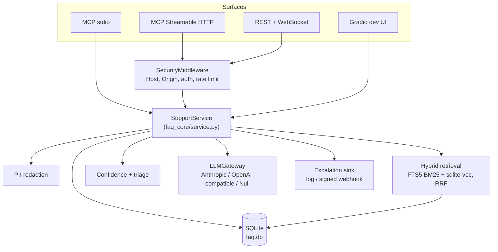

# Customer Support Assistant

An agent-first customer-support knowledge service. A FastMCP server whose main consumer is an AI
agent, backed by SQLite with an in-house hybrid retrieval stack (FTS5 BM25 plus `sqlite-vec`,
fused with Reciprocal Rank Fusion). One framework-free business layer, `SupportService`, sits
behind three thin surfaces: MCP (stdio and Streamable HTTP), REST + WebSocket, and a Gradio dev UI.

The repo and package name is still `customer-support-faq`.

## Features

- **Hybrid retrieval**: heading-aware chunking, BM25 + dense vectors, RRF fusion, near-duplicate
  removal, optional reranker (Cohere API or local BGE). Citations with title, heading, snippet,
  source URI, freshness date and score.
- **Three LLM access modes** (`LLM_MODE`): `api` (server calls a provider with your key),
  `client` (the calling agent's own model writes the reply from `search_kb` passages; no LLM here),
  `offline` (local LLM and embedder; a startup guard refuses non-local endpoints).
- **Confidence, outcome and escalation**: every search returns a heuristic confidence and one of
  `answer`, `answer_with_caveat`, `escalate`. Triggers: low confidence, repeated rephrasing,
  frustration, PII, legal/medical topics. Hand-off packets go to a log or a signed webhook.
- **Knowledge-gap loop**: unanswered and low-confidence queries are clustered into a ranked content
  backlog.
- **Resolution metrics and a weekly gap report**: outcome counts, escalation rate and a 48-hour
  re-contact proxy.
- **PII redaction** of customer text before retrieval, the LLM, traces, logs and storage.
- **Authenticated remote access**: static bearer keys or an OAuth 2.1 resource server (JWT access
  tokens), Origin and Host checks, rate limits. stdio MCP is unauthenticated by design.
- **Ingest** markdown, text, HTML, CSV, FAQ JSON, folders and URLs (CLI only).

## Architecture



Details: [docs/architecture.md](docs/architecture.md).

## Quick start

Requires Python 3.13.

```bash
python3.13 -m venv .venv && source .venv/bin/activate
pip install -r requirements.txt -r requirements-dev.txt
cp .env.example .env            # edit: choose LLM_MODE and add keys
python app.py --mode mcp        # MCP over stdio
```

For REST, set a static key first (the server exits with status 2 without one):

```bash
python -c "import secrets; print(secrets.token_urlsafe(32))"   # put into .env as API_KEYS=app:<token>
python app.py --mode api                                       # 127.0.0.1:8000
curl -s -X POST http://127.0.0.1:8000/kb/search \
  -H "Authorization: Bearer <token>" -H "Content-Type: application/json" \
  -d '{"query": "How do I reset my password?"}'
```

`LLM_MODE=client` needs no LLM key. `api` mode needs a provider key. Step-by-step instructions for
every mode and surface: [howto.md](howto.md).

## Documentation

| Doc | Content |
|---|---|
| [howto.md](howto.md) | Install, configure each mode, run each surface, ingest, call the tools, webhook, metrics, Docker, troubleshooting |
| [docs/configuration.md](docs/configuration.md) | Every environment variable |
| [docs/api-reference.md](docs/api-reference.md) | MCP tools, REST routes, WebSocket |
| [docs/architecture.md](docs/architecture.md) | Layers, request flow, data model, events, decisions |
| [docs/operations.md](docs/operations.md) | Security checklist, backups, monitoring, tuning, upgrades, limits |
| [docs/remote-mcp.md](docs/remote-mcp.md) | Remote MCP, OAuth, connecting Claude and ChatGPT |
| [docs/evaluation.md](docs/evaluation.md) | Evaluation: retrieval benchmark, resolution metrics, RAGAS gate (unverified live) |
| [plan.md](plan.md) | The revamp plan and decisions |

## Status and limits

Phases 0-5 of the revamp (core service, hybrid retrieval, LLM modes, support workflow, remote MCP
and auth) are built and tested. Resolution metrics and the weekly gap report (Phase 6) are in
place. The RAGAS gate is ported to the current API but has never run against a live LLM (see
[docs/evaluation.md](docs/evaluation.md)).

Not verified, because it has never been run live:

- any real LLM call (the `.env` key is a placeholder);
- Claude or ChatGPT connecting to the remote MCP server, a real authorization server, a tunnel;
- sentence-transformers, bge-m3 and the BGE reranker (the lite install uses a hashing embedder);
- Gradio, Docker build and compose, CI (there is no git repository), a real Langfuse project;
- RAGAS scores.

Confidence is a heuristic, not a calibrated probability, and was tuned on a 24-query benchmark with
the hashing embedder. Retrieval benchmark (hybrid, hashing embedder): recall@1/3/5 =
0.875/0.958/1.0, MRR 0.920; run `python -m faq_core.retrieval.benchmark`.

## Quality gates

All must pass; use the venv's tools.

```bash
source .venv/bin/activate
ruff check . && ruff format --check .
mypy --strict app.py bootstrap.py server.py remote_mcp.py faq_core/ api/ background/ formatters/ observability/ ui/
pytest tests/ -m "not rag" -q
grep -rn "sk-ant\|sk-proj\|AIza\|Bearer [A-Za-z0-9]" --include="*.py" . --exclude-dir=.venv   # must print nothing
```

## License

No license file is present in this repository.
