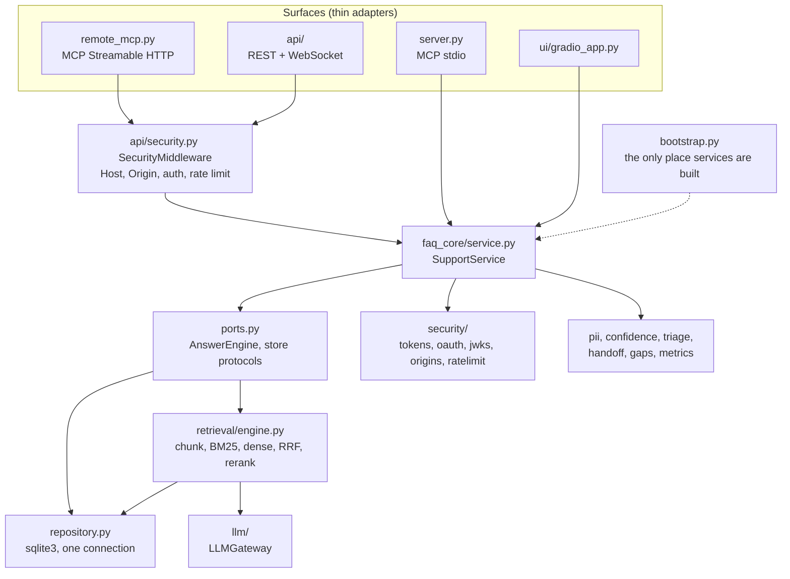
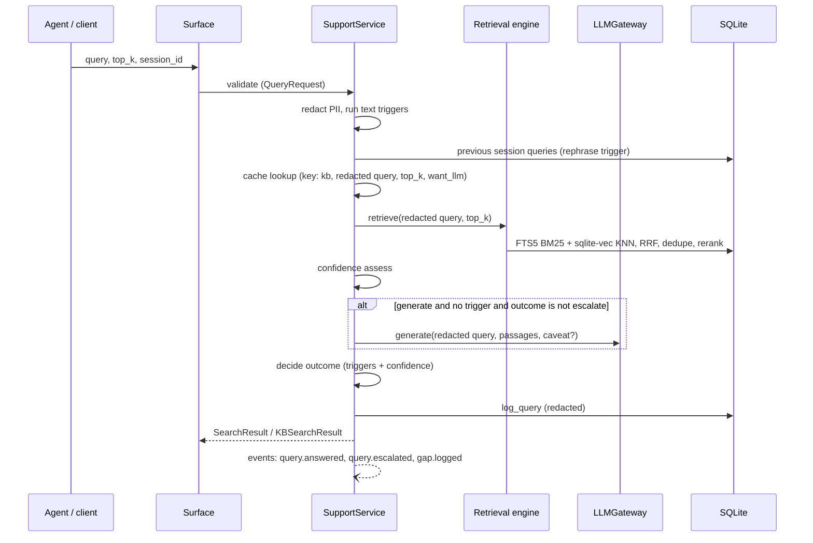

# Architecture

How the Customer Support Assistant is put together. Source of truth is the code; the decisions
come from [plan.md](../plan.md) section 6. Back to the [README](../README.md).

## Layers

| Layer | Where | Role |
|---|---|---|
| Composition root | `bootstrap.py` | Builds config, gateway, repository, engine, scheduler, service; seeds an empty KB; always runs `sync_index()` at start; closes everything |
| CLI | `app.py` | `--mode mcp\|api\|ui\|ingest\|report`, `--transport stdio\|http`, `--host`, `--port`; runs the offline network guard first |
| Surfaces | `server.py`, `remote_mcp.py`, `api/`, `ui/` | Translate transport input into `SupportService` calls and serialise pydantic results. No business logic |
| Business layer | `faq_core/service.py` | `SupportService`: search, answer, `search_kb`, add/get entries, categories, feedback, escalation, gaps, metrics, seed, `sync_index`, ingest. No web or MCP imports |
| Ports | `faq_core/ports.py` | Interfaces for the answer engine and the store, so tests use fakes |
| Retrieval | `faq_core/retrieval/` | Heading-aware chunking, `chunks` + FTS5, `sqlite-vec` vectors, embedders (`hashing` default, `local`, `openai`, `ollama`), retriever (BM25 + dense, RRF, near-duplicate removal, optional reranker), indexer, ingest, benchmark |
| LLM | `faq_core/llm/` | `LLMGateway` protocol, Anthropic and OpenAI-compatible adapters, `NullGateway` for client mode, provider presets, local circuit breaker |
| Support workflow | `pii.py`, `confidence.py`, `triage.py`, `handoff.py`, `gaps.py`, `metrics.py` | Redaction, scoring, escalation triggers, hand-off packets and sinks, gap clustering, resolution metrics and report |
| Security | `faq_core/security/` | Static keys, JWT verification, JWKS cache, Origin/Host allowlists, rate limiter, fail-closed policy builder |
| Background | `background/` | APScheduler 4.0.0a6; re-index job triggered by `faq.added` |
| Observability | `observability/` | Langfuse `@observe` wrapper, redacting logger, optional circuit-breaker alerting |

Rules that follow from this (also in `CLAUDE.md`): adapters never build services or read `.env`
(`faq_core/config.py:get_config()` is the only reader); routes use the `ServiceDep` alias in
`api/deps.py`; secrets are `SecretStr` fields and are unwrapped only inside constructors.

`server.mcp` is built lazily because the tool list depends on `LLM_MODE` (`answer_question` exists
only when the server generates answers).

## Request flow for a search

`search_kb`, `search_faq` and `answer_question` (and `POST /search`, `/kb/search`, `/answer`) all go
through `SupportService._run`.

1. **Validate.** `QueryRequest`: non-blank query, `top_k` 1-20, `session_id` of `[A-Za-z0-9._:-]`,
   at most 128 characters. Errors become `invalid_request`.
2. **Prepare.** The query is PII-redacted (`PII_REDACTION`). Everything afterwards sees only the
   redacted text. Text triggers run on it (frustration, PII, legal/medical terms). With a
   `session_id`, the last `ESCALATION_REPHRASE_WINDOW` session queries are compared for the
   repeated-rephrase trigger.
3. **Cache.** An in-process TTL cache with a per-key lock (`AsyncStampedeCache`) holds the retrieval
   and generation result. Triggers and the outcome are re-evaluated on every call, so `cached` only
   says the expensive part was reused. Each call gets a fresh `query_id`.
4. **Retrieve.** BM25 over `chunks_fts` and, when `sqlite-vec` loaded, dense KNN over `chunk_vec`;
   fused with RRF (`RETRIEVAL_RRF_K`), near-duplicates dropped (`RETRIEVAL_DEDUPE_THRESHOLD`),
   optional reranker. Without `sqlite-vec` retrieval is BM25 only (warning in the log).
5. **Confidence.** Weighted mean of query-term coverage (0.4), dense similarity (0.3), BM25/dense
   agreement (0.2), margin over the runner-up (0.1), plus a reranker score (0.3) when present,
   renormalised over the signals that exist. `>= CONFIDENCE_ANSWER_THRESHOLD` is `answer`,
   `>= CONFIDENCE_CAVEAT_THRESHOLD` is `answer_with_caveat`, otherwise `escalate`. The result carries
   `calibrated: false`.
6. **Triage.** Any fired trigger forces `escalate`. No LLM call is spent when a text trigger already
   decided it.
7. **Generate or hand off.** `answer_question`/`search_faq` in `api`/`offline` mode call the LLM
   with only the retrieved passages (and a caveat instruction for medium confidence). The optional
   self-check (`CONFIDENCE_SELF_CHECK`) can only lower the outcome. `escalate` never produces an LLM
   answer: `answer` is a fixed hand-off message (empty in client mode) and `generated` is `false`.
   `search_kb` never calls an LLM.
8. **Log.** One `query_log` row with the redacted query, outcome, reasons, confidence, citations,
   a redacted answer preview, latency and `session_id`. Rows whose outcome is not `answer` form the
   knowledge-gap log. Events are emitted afterwards.

Escalation is a separate call (`create_escalation`): it builds a redacted packet from the logged
attempts and caller input, stores it in `escalations`, and delivers it through the configured sink.

## Data model

One SQLite file (`DB_PATH`, default `./data/faq.db`). Schema is managed by versioned SQL in
`faq_core/migrations.py` (never edit a released migration; append a new one). All tables carry a
`kb_id` (default `default`) so the schema is tenant-ready, though one knowledge base is used.

| Table | Purpose | Added in migration |
|---|---|---|
| `schema_version` | applied migrations | bookkeeping |
| `faq_entries` | FAQ question, answer, category, `kb_id`, `created_at` | 1, 2 |
| `feedback` | rating 1-5, helpful flag, comment, `query_id`, `kb_id`; one row per `(kb_id, query_id)` (unique index, upserted: the latest rating wins) | 1, 2, 6 |
| `chunks` | retrievable slices of an FAQ entry or document: heading, content, hashes, `updated_at`, `source_uri`; belongs to `faq_id` or `document_id` | 3, 4 |
| `documents` | ingested documents, unique per `(kb_id, source_uri)`, with `content_hash` | 4 |
| `chunks_fts` | FTS5 virtual table (Porter + unicode61) over title, heading, content | 4 |
| `index_meta` | key/value, records the embedder signature | 4 |
| `chunk_vec` | `sqlite-vec` `vec0` table; created at runtime, not by a migration (needs the extension and the embedder dimension) | runtime |
| `query_log` | every search: redacted query, surface, confidence, outcome, reasons, citations, session id, latency | 3, 5 |
| `escalations` | hand-off packet (JSON), status `open`/`sent`/`resolved`, delivery result, session id | 3, 5, 6 |

Migration 6 (`metrics_indexes_and_unique_feedback`) adds `(kb_id, created_at)` indexes on
`feedback` and `escalations` (`query_log` has had one since migration 3) for the bounded metrics
reads, collapses pre-existing duplicate ratings to the latest per `(kb_id, query_id)`, and creates
the unique `(kb_id, query_id)` index on `feedback`. File databases run in WAL mode with a 5 s busy
timeout.

The scheduler's own store is separate and optional: set `SCHEDULER_DB_URL` for a persistent
re-index queue; otherwise it is in memory and lost on restart (the startup `sync_index()` repairs
that).

An embedder name or dimension change invalidates `chunk_vec`; the next start drops and rebuilds the
vectors.

## Events

A typed in-process bus (`faq_core/events.py`). `emit()` is fire-and-forget (each handler runs as a
task; failures are logged, never propagated); `publish()` waits for all handlers. Payloads are JSON
scalars. Nothing leaves the process.

| Event | Emitted when | Used by |
|---|---|---|
| `faq.added` | `add_faq_entry` / `POST /faq` stored an entry | re-index job |
| `faq.indexed` | the job finished indexing | clears the answer cache |
| `query.answered` | every search (redacted query and answer preview) | observers |
| `query.escalated` | outcome is `escalate` | observers |
| `gap.logged` | outcome is not `answer` | observers |
| `escalation.created` | `create_escalation` stored a packet | observers |
| `feedback.received` | feedback recorded | observers |
| `metrics.reported` | weekly gap report computed (REST or CLI; aggregates only) | observers |

## Concurrency

- The server is `asyncio`. SQLite access goes through `FAQRepository`, which owns **one connection
  on a single-thread executor** (`ThreadPoolExecutor(max_workers=1)`); every query is submitted to
  that thread, so there is no cross-thread connection sharing and writes are serialised. `commit()`
  is explicit after each write.
- Model loading and DB migration run in `asyncio.to_thread` at start so the loop is not blocked.
- Knowledge-gap clustering (metrics, report, `list_knowledge_gaps`) runs in `asyncio.to_thread`;
  only the embedding call stays a coroutine. Metrics results are cached per window
  (`METRICS_CACHE_TTL`, stampede-protected like the answer cache).
- Identical concurrent searches share one computation (per-key `asyncio.Lock`).
- The cache, rate limiter and JWKS cache are per process. Several workers each keep their own.
  SQLite runs in WAL mode with `busy_timeout=5000` so several processes can share the file, but
  that has not been load-tested.
- Over Streamable HTTP the MCP SDK enters the server lifespan per session, so `remote_mcp.py` passes
  a lifespan that yields one shared service.

## Security model (summary)

Every HTTP surface sits behind `SecurityMiddleware`: Host check, Origin check, authentication, rate
limit, in that order. Only `GET /health` (and, in OAuth modes, the protected-resource metadata) is
open. The `Authorization` header is removed before any route or tool runs, so a token is never
forwarded upstream. A bad auth configuration stops the server at start (exit 2). stdio MCP is not
authenticated. Details: [remote-mcp.md](remote-mcp.md) and [operations.md](operations.md).

## Key design decisions

From plan.md section 6, plus choices made in later phases:

| Decision | Choice | Why |
|---|---|---|
| Retrieval stack | In-house pipeline: SQLite FTS5 for BM25 plus `sqlite-vec` for dense vectors. Haystack and Chroma removed | One file, no extra services, small dependency set. Qdrant is an optional later backend (`VECTOR_STORE=qdrant` currently falls back to `sqlite-vec` with a warning) |
| Internal wheels | Dropped (the last one, `api_client_base`, went in Phase 3) | They forced unrelated installs and carried workarounds |
| Handoff target | Deferred; ships a `log` sink and an HMAC-signed `webhook` sink only | Real usage will decide the helpdesk. Adapters implement `EscalationSink` |
| Tenancy | One small knowledge base, `kb_id` column kept | Enough for now, easy to extend |
| Primary consumer | An AI agent: structured JSON, stable fields, explicit `outcome`/`escalate` flags, no prose-only returns. Field names are never renamed or removed, only added | Agents need a contract they can rely on |
| `client`-mode hosting | Deferred. The transport exists; where to host is chosen when needed | |
| LLM access | One switch, `LLM_MODE` (`api`, `client`, `offline`); no attempt to drive consumer chat subscriptions programmatically | `client` mode is the supported path for subscribers: their chat app connects over remote MCP and writes the reply |
| MCP SDK | Stay on `mcp` 1.x (`>=1.10,<2`) with our own ASGI authentication | 1.x had Streamable HTTP and Host/Origin checks; 2.x renamed `FastMCP` |
| Ingest | CLI only | No MCP or REST route means no SSRF through an agent |
| PII | Redact customer text before it reaches retrieval, the LLM, traces, logs and storage; never redact the KB | Keeps personal data out of every downstream system |

## Known limits

See [operations.md](operations.md#known-limits).
